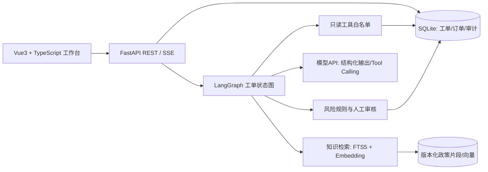
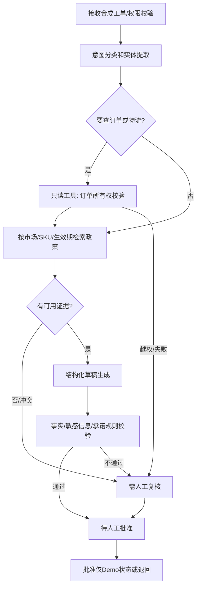

# CrossCare Agent 技术架构与工程约束

**本文是拟开发设计，并非现成实现。** 选型以14天完成稳定Demo为约束。[技术建议] 直接回应[沅达](https://www.zhaopin.com/jobdetail/CC464665920J40874615109.htm)的Webhook/API、RAG、兜底，[浪潮](https://www.zhaopin.com/jobdetail/CC120143600J40973244015.htm)的FastAPI、工具调用、评测和日志，以及[两万里](https://www.zhaopin.com/jobdetail/CC823862260J40803549006.htm)的Agent状态管理要求。[招聘证据]

## 1. 技术选型及可替换界面

| 模块 | MVP选型 | 原因与限制 |
|---|---|---|
| 前端 | Vue3、TypeScript、Vite、Pinia、ECharts（评测页）、SSE | 最大化既有前端经验；流程状态与证据呈现比通用聊天UI重要 |
| API | Python 3.11+、FastAPI、Pydantic v2 | 与BidGuard经验一致；API、Schema、工具边界易演示 |
| 编排 | LangGraph一个受控状态图 | 复用已会技术，但新增工具路由、失败恢复、状态可视化；不为“多Agent”而拆多个角色 |
| 事务数据库 | SQLite（单机演示）、SQLAlchemy/SQLModel任选其一 | 20–30文档、数十工单足够；生产多用户应迁移PostgreSQL |
| 检索 | SQLite FTS5 + Embedding向量相似度（持久化向量表/JSON）+ RRF融合 | 小数据无需另起重型向量服务；模型API不可用时标为词法降级；不得宣称已使用Milvus/pgvector |
| Rerank | 首版不做独立Cross-Encoder；评测显示关键词/向量融合结果 | 本样本无JD明确点名Rerank；优先完成可靠工具与评测，若Recall@3不达标再加rerank |
| 模型 | 可配置OpenAI兼容接口；服务端保存密钥；固定温度；离线回放测试 | 不绑定真实店铺；没有模型凭据时只可运行回放/静态Demo，须标明 |
| 运行 | Docker Compose（前端、后端；SQLite持久卷） | 对应紫光Docker/Compose部署要求；启动、健康检查、seed一键化 |

## 2. Agent状态图

**状态字段：** `ticket_id, customer_id, intent, entities, retrieved_chunk_ids, tool_calls, tool_results, draft, risk_flags, errors, model_trace_id, status, retry_count, updated_at`。状态写入前先通过Pydantic校验；节点应可幂等重入。`tool_calls`记录工具名、脱敏参数、结果摘要、耗时、错误码；不记录密钥和完整个人数据。

## 3. RAG知识库

- **数据来源：** 自编合成商品说明、退换货政策、时效说明、FAQ；每条标注 `source_id/version/market/SKU/effective_from/effective_to`。真实商家材料必须先获授权。
- **入库：** 清洗Markdown/文本→按语义小节分块（约300–600中文字符或对应英文长度）→保留标题与政策编号→生成Embedding→索引版本化。更新政策先产生新版本，旧工单引用仍指向旧版本。
- **检索：** 先做市场/SKU/有效期过滤，再词法与向量各取Top5，用RRF合并取Top3；无检索结果、分数过低或政策冲突时转人工。政策以数据库的有效期与版本为准，模型不得自行“调和”冲突。
- **引用：** 草稿每条政策性断言需关联 `chunk_id` 和可点击标题/版本；工具事实引用 `tool_result_id`、查询时间。不能提供引用的句子标为待核对。
- **评测：** 固定20条带金标准文档ID的数据集，计算Recall@3；另测过期政策、跨市场串用、恶意提示注入、无文档问题。

## 4. 工具、接口与数据库

**模型可调用工具只有两个：** `get_order_summary(order_id, customer_id)` 和 `get_tracking_events(order_id, customer_id)`。服务端从已验证工单状态注入 `customer_id`，忽略模型自由生成的客户身份；订单查询强制 `WHERE order_id=? AND customer_id=?`。返回字段白名单，不给地址/支付等敏感字段。知识检索是内部节点，模型不能任意执行SQL、HTTP或Shell。未来平台API通过同一只读适配器接口接入，只有用户授权、平台许可和审计就绪后再设计。[技术建议]

| 表 | 关键字段 |
|---|---|
| `customers` | `id, demo_name, locale`；全为合成身份 |
| `orders` | `id, customer_id, sku, market, status, placed_at` |
| `tracking_events` | `id, order_id, event_time, code, location, description` |
| `tickets` | `id, customer_id, order_id?, channel='demo', message, status, created_at` |
| `policy_documents` | `id, title, version, market, sku?, effective_from, effective_to, checksum` |
| `policy_chunks` | `id, document_id, section, text, embedding_ref, fts_rowid` |
| `agent_runs` | `id, ticket_id, graph_state, model, latency_ms, estimated_tokens, error_code` |
| `tool_calls` | `id, run_id, tool_name, args_redacted, result_ref, status, latency_ms` |
| `reviews` | `id, ticket_id, reviewer_demo_id, action, edited_draft, reason, created_at` |
| `eval_cases` / `eval_results` | `case_id, expected_intent, expected_chunk_ids, expected_tool, expected_risk; result/score/version` |

**REST接口：** `GET /tickets`、`GET /tickets/{id}`、`POST /tickets/{id}/runs`、`GET /runs/{id}/events`（SSE）、`POST /tickets/{id}/reviews`、`GET/POST /policies`、`POST /policies/reindex`、`POST /evals/run`、`GET /evals/{id}`、`GET /health`。所有修改接口都要求演示身份和CSRF/同源保护；`POST /reviews`只改变内部状态，不对外发送。

## 5. 失败、安全与可观测

- 429/5xx/网络超时：最多2次指数退避，超过后记录`model_unavailable`并进入人工；工具查询超时不能产生“无物流异常”结论。`run_id`幂等键防止重复生成与重复审核。
- 模型返回不合法JSON：一次修复重试；再次失败保存原始脱敏错误、转人工。订单越权、缺少订单号、政策过期、来源冲突、未授权动作需求均产生可解释风险旗标。
- Prompt注入：系统指令与检索内容分层，工具权限由后端强制执行；模型不能改变白名单。日志只存脱敏输入及哈希，不输出API密钥。Demo用户不可上传真实顾客数据。
- 指标：请求成功率、模型/工具错误率、p50/p95延迟、检索Recall@3、草稿人工修改率、越权拦截数、Token估算。演示版只展示合成数据指标，不宣称生产SLA。

## 6. 部署与演示环境

本地Docker Compose启动前后端，SQLite目录挂卷；`.env.example`列出模型端点、模型名、API key占位符，不提交真实密钥。`seed_demo`生成固定随机种子的合成数据；`reset_demo`仅清理Demo数据。README写明Windows运行步骤、无密钥回放模式、测试命令、模型成本上限、合成数据声明。上线公共互联网前还需实际身份认证、速率限制、密钥轮换和数据保留政策；14天MVP不应宣称生产可用。[技术建议]
